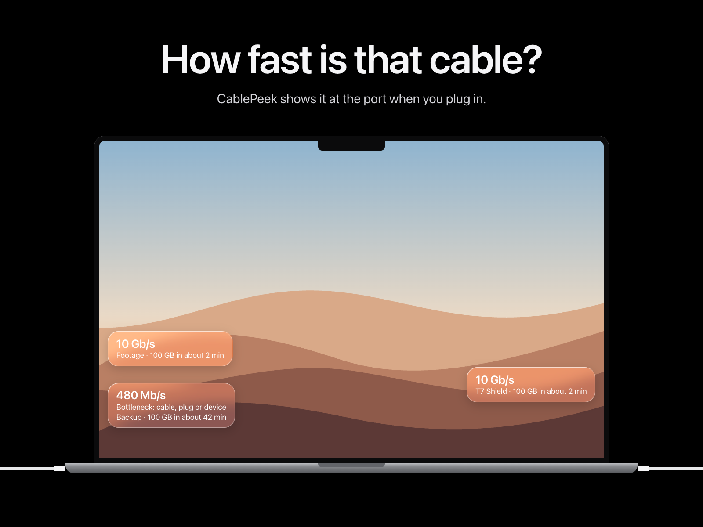

# CablePeek

A small Mac app that shows the USB-C link speed at the screen edge next to the port when you plug something in. It stays for four seconds. Hover at that edge to see it again or eject the drive.



*Illustration, not a screenshot.*

Download: https://cablepeek.pages.dev or the [latest release](../../releases/latest).

## Good to know

- Apple Silicon, macOS 14 or later. Liquid Glass on macOS 26, frosted glass before that.
- **Not signed and not notarized.** The build has only an ad hoc signature, so macOS warns you on first launch. You can build it yourself instead.
- Tested on one MacBook Pro with M2 Pro so far. Reports from other Macs are welcome.
- Link speed depends on cable, plug and device. If the cable has a readable chip, CablePeek uses it. If it cannot tell what is slow, it says so.
- Copy times are best-case estimates from the link speed, not measurements.
- It reads port information, drive names and the pointer position. It does not open files or use the network.
- It ejects only when you click the button and never forces an eject.

## Build

Needs the Xcode command line tools with a macOS 26 SDK.

```sh
./build.sh
open CablePeek.app
```

`CablePeek.app/Contents/MacOS/CablePeek --dump` prints what it reads, which is handy for bug reports. It includes your drive names.

## How it works

Everything comes from the IORegistry: the port position (`port-location`), the USB link speed (`UsbLinkSpeed`) and the cable's e-marker data. Ejecting uses DiskArbitration. Code comments are in German.

For deeper cable and power diagnostics, use [WhatCable](https://github.com/darrylmorley/whatcable).

Built with help from Claude. MIT license. Not affiliated with Apple.
